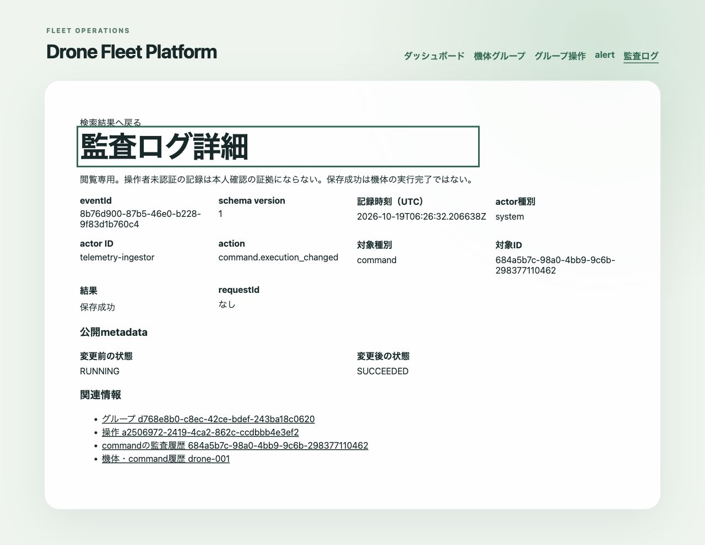

# audit logの検索と閲覧

#145で一覧・詳細APIとダッシュボードの「監査ログ」を追加した。閲覧専用で、読み取り自身はauditを増やさない。認証・権限制御は未実装のため、ローカルまたは制限したネットワークで使う。

## APIとページ送り

- `GET /audit-logs`: `{items, limit, nextCursor}`。limitは1〜100、既定20。全件数は計算しない。
- `GET /audit-logs/:eventId`: 1件の公開情報。不存在は404。
- 不正な検索条件・UUID・cursorは400、DB障害は500。更新・削除APIはない。

一覧は`from`・`to`（両端を含むUTC ISO時刻、小数秒0〜6桁）、`actorKind`、`actorId`、`action`、`targetKind`、`targetId`、`result`、`requestId`、`groupId`、`operationId`、`commandId`、`alertId`の完全一致で絞る。指定した条件はANDになる。actorKindはanonymous/system、actorIdはtelemetry-ingestor/alert-evaluator/operation-evaluator、resultはSUCCEEDED/REJECTED/FAILED。actionとtargetKindは[audit log](audit-log.md)の記録種別に従う。

```text
GET /audit-logs?action=command.execution_changed&from=2026-10-19T00%3A00%3A00Z&limit=20
GET /audit-logs?requestId=3246dc82-ec58-4f8c-a6a7-d143667befc8
```

`occurredAt DESC NULLS LAST, eventId DESC NULLS LAST`で固定する。次ページは応答のnextCursorをそのままcursorへ渡し、他の検索条件は維持する。cursorは時刻とeventIdをbase64urlで符号化した位置情報であり、署名や認可情報ではない。時刻をJavaScript Dateへ丸めず、DBのマイクロ秒6桁を維持して同時刻の境界も扱う。offsetは使わない。

画面は条件とcursorをURLに保存し、条件変更時は先頭へ戻る。「次の20件」、ブラウザの戻る、「検索の先頭へ」で移動できる。自動更新はせず、新規記録は先頭を再取得して確認する。ページをまたぐDB snapshotではないため、後からcommitされた古い時刻の行まで固定する保証はない。

## 公開情報と関連リンク

APIは公開項目を明示し、metadataもaction別の許可リストと型検証を通す。名前変更、descriptionの変更有無、membershipのdeviceId、command種別、対象数、前後状態、固定理由コード、HTTP statusCodeだけを用途に応じて返す。description本文、要求本文、header、証明書、未知キーは返さず、画面にも生のJSONを出さない。group名は表示対象なので秘密情報を書かない。

詳細からgroup・operation・alert・deviceへ移動でき、同じrequestIdの記録も検索できる。command専用詳細APIは既存にないため、commandIdの監査履歴と機体のcommand履歴（最新100件）へ案内する。group・操作・alert詳細とcommand行からも監査検索へ移動できる。関連IDは履歴として残すが、不存在・削除された対象のリンクは404になり得る。command/alertから解決するdeviceIdも関連行がなければ表示しない。

保存成功は機体の実行成功ではない。anonymousは「操作者未認証」と表示し、server requestIdを本人確認として扱わない。[記録と改ざん耐性の境界](audit-log.md)も参照する。

## 索引と計測

migration `0011`で時刻索引のeventIdを降順に揃え、actor・action・resultと時刻/eventIdの複合索引を追加した。既存のrequestId・operationId・commandId・対象索引は維持する。通常のCREATE INDEXなので書き込みサービスを停止して移行し、完了後に再開する。オンライン無停止移行は保証しない。

2026-10-19、macOS 14.5 arm64、Node.js 24.21.0、pnpm 10.28.1、OrbStackのPostgreSQL 17専用DBで10万件を生成し、ANALYZE後の実repository SQLを計測した。99%はanonymous/group.created/SUCCEEDED、1%はsystem/command.conflict/REJECTED。全件で同じtargetIdとrequestIdを持ち、時刻は2026-10-20T00:00:00Zから1マイクロ秒刻みとした。既存の少数の結合テスト行も含む。LIMIT20に次ページ判定の1件を加えたSQLを使い、planner設定は変更していない。

| 条件 | repository中央値 ms | EXPLAIN実行時間 ms | audit索引 |
| --- | ---: | ---: | --- |
| 先頭 | 14.392 | 0.201 | occurred |
| 期間 | 7.127 | 0.700 | occurred |
| action | 7.659 | 0.208 | action_time |
| actor | 5.810 | 0.191 | actor_time |
| 対象 | 7.260 | 0.758 | occurred |
| result | 5.485 | 0.164 | result_time |
| requestId | 15.684 | 0.351 | occurred |
| 約9万件先のcursor | 7.342（1回） | 0.164 | occurred |

先頭〜requestIdは3回の中央値。repository時間は転送・公開項目変換を含みHTTPは含まない。EXPLAINは別実行。いずれもauditのIndex Scanから21行を読み、Sortはなかった。深いcursorも索引の位置条件で読む。対象・requestIdは全件に一致するため時刻索引が選ばれた。関連command/alert表は空で、これらの小表のSeq Scanはaudit全件走査とは異なる。[全試行値と実行計画](audit-query-plan.json)を保存した。

キャッシュは温まった状態で、同時にComposeのbuildも動作していた。ローカルの観測値であり、本番の応答保証、あらゆる複合条件・大量関連行・長期保持の性能保証ではない。索引順とORDER BYのNULL順も明示的に揃えた。実AWSや100台の継続負荷はこの検証に含めない。

## 検証

API・repository・UIテストで入力拒否、全検索条件、公開情報の制限、同時刻とマイクロ秒境界のページ送り、新規記録追加後の重複・欠落防止、関連リンク、loading/empty/error/retryを確認する。専用Composeでは実際のgroup作成とcommand送信から記録を作り、ブラウザで検索・ページ送り・詳細を確認する。

2026-10-19に`pnpm check`（683件成功、条件付き115件skip）、専用DBの`DATABASE_INTEGRATION=true pnpm api:test:integration`（65件成功、既存の条件付き1件skip）と`DATABASE_INTEGRATION=true pnpm db:test:integration`（3件成功）を確認した。`pnpm db:generate`で追加差分はない。仮想2台の専用Composeでは25 groupを作成し、1台へのRETURN_HOMEがSUCCEEDEDとなった記録から検索・キーボードのページ送り・詳細・関連operationへの移動を確認した。


