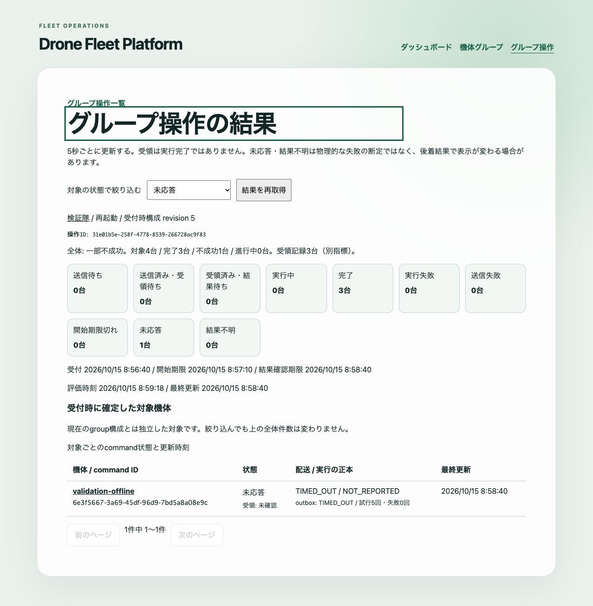

# グループ操作と結果の追跡

#141でgroup詳細から複数機体へ帰還・再起動を送り、operationごとの結果を追跡する画面を追加した。[受付・集約API](fleet-operations-api.md)を使い、MQTT・DBには直接接続しない。

## 送信

1. 「機体グループ」から対象groupを開き、「全機体への帰還を確認」または「全機体への再起動を確認」を選ぶ。
2. group名、種類、対象台数、ONLINE / OFFLINE / 状態未取得の内訳を確認する。OFFLINEも対象に含める。初回の構成・接続状態を取得できない場合や空groupでは新規送信できない。
3. 全機体への操作、配送待ち、重複操作、再起動による切断のリスクへチェックを入れて確定する。確認中に取得済みrevisionが変わった場合はキャンセルし、対象を確認し直す。
4. APIが受け付けると`/fleet-operations/:operationId`へ移動する。実際の対象と台数はこの画面を正本として確認する。

確認画面はその時点のプレビューであり、API受付まで構成をロックしない。最終対象は受付transaction内で固定される。受付後の所属・名称変更やgroup論理削除では過去の対象を変えない。全件同時開始・全件成功、同一機体のcommand順序は保証せず、受付後のキャンセル・自動再実行は提供しない。

確認時に同じgroupのACCEPTED / IN_PROGRESSのoperation数を取得する。別groupや単一機体の未終端commandはこの件数に含まれず、排他制御の代わりにはならない。取得できない場合もその旨を表示し、リスク確認を必須とする。

## 二重操作と通信エラー

確定時にランダムな`Idempotency-Key`を生成し、API接続先・groupごとにタブのsessionStorageへgroupId・種類・keyを保存してからPOSTする。連打は同期的な送信ガードとボタンの無効化で止め、自動のPOST再試行はしない。15秒の通信タイムアウトは操作のキャンセルではない。

受付結果が不明なときは新しい操作を作らず、「同じ要求で受付を確認」を使う。再読み込みやgroup画面への戻りでも同じkeyと本文を復元し、自動送信せず明示的な確認を待つ。元の要求が受け付けられていれば同じoperationへ戻る。元の要求がAPIへ届いていなければ、再送時に初めて受け付けられる場合があり、その時点の構成が対象になる。

正常な202と要求に一致するreceiptを検証できたときだけ保存要求を解除し、結果画面へ遷移する。HTTPエラー・不正応答では保持する。保存領域の利用不可・破損・保存失敗では新しいPOSTを送らず、履歴確認を案内する。

keyはこのタブ内での再送を結び付けるもので、別タブ・別ブラウザ間の操作を自動統合しない。タブを閉じる、保存領域を消す、API接続先を変える前には操作履歴を確認する。受付不明のまま新しいkeyで操作し直すと二重操作になり得る。

## 結果

メインナビゲーションの「グループ操作」から履歴を開ける。group詳細の「このグループの操作履歴」はgroupIdで絞る。一覧は20件、対象機体は25台ずつサーバー側でページ分割する。

詳細URLと絞り込みstatus・offsetは再読み込み、ブックマーク、ブラウザの戻る操作で復元できる。結果を開くだけでPOSTしない。受付時のgroup名・revision、確定した対象台数、operationId、全体状態と全10分類の件数、受領記録、開始期限・結果確認期限、評価・更新時刻を表示する。対象行はdeviceId、commandId、表示状態、配送/実行の正本、outboxと試行数、受領・更新時刻を持ち、機体詳細へ移動できる。

受領済みは結果待ちであり完了ではない。全件完了、一部不成功、全件不成功を分ける。不成功には送信失敗・期限切れ・未応答・結果不明も含むため、物理的な失敗と断定しない。各状態と120秒の期限評価は[API文書](fleet-operations-api.md)・[ADR 0006](adr/0006-fleet-operations-alerts-and-audit.md)に従う。

対象の絞り込みは完了、実行失敗、送信失敗、開始期限切れ、未応答、結果不明などを個別に選べる。絞り込んでも全体の件数は変わらない。0件や範囲外pageは空表示になり、前のページへ戻れる。

画面を開いている間は5秒ごとに再取得する。後着結果があるため終端表示後も更新を続け、画面を離れると周期取得を止める。API失敗時は前回の値を残して失敗を明示し、手動再取得できる。新しいpageや条件へ切り替えると旧pageを表示せず読み込み状態を示す。存在しないoperation、不正なID・query、未設定APIも成功表示に置き換えない。

## アクセシビリティと検証

操作はbutton・checkbox・label付きselectで行える。確認開始時はキャンセルへフォーカスし、Escapeで閉じると操作見出しへ戻す。結果画面への遷移では見出しへフォーカスする。確認は非モーダルであり、フォーカストラップを設けない。状態は色だけに頼らず日本語で表示し、全体状態はlive region、エラーはalertで通知する。結果tableはcaption・列/行見出しを持ち、狭い画面ではキーボードでフォーカスできる領域内を横スクロールする。

`pnpm --filter @drone-fleet/dashboard test`で確認・取消・連打、保存失敗、通信エラー後と再読み込み後の同一key、構成変更検出、全体/機体別表示、失敗/期限切れ/未応答のfilter、100台を25台ずつ表示、周期更新・画面離脱・再取得、URL直接表示を検証する。既存の単一機体操作テストも維持する。`pnpm check`でルートからのテスト、型チェック、lint、buildを確認する。

実AWSでの画面操作、別タブ間の重複抑制、大量履歴の性能、スクリーンリーダー実機での読み上げはこの変更の検証範囲外である。

2026-10-15に専用Compose project、PostgreSQL 17、Mosquitto、simulator 3台とOFFLINEの試験用1台で実ブラウザ確認を行った。画面からgroupを作成して所属を追加し、帰還3台の完了、再起動3台の完了とOFFLINE 1台の未応答、絞り込み後も全体件数を保持すること、URL再読み込み、確認と遷移後のフォーカスを確認した。APIのCORSを含む実経路を使用し、試験終了後に専用コンテナ・volumeを削除した。100台のDOM件数・page切り替えはUIテストのfixtureであり、100台の実MQTT試験ではない。
